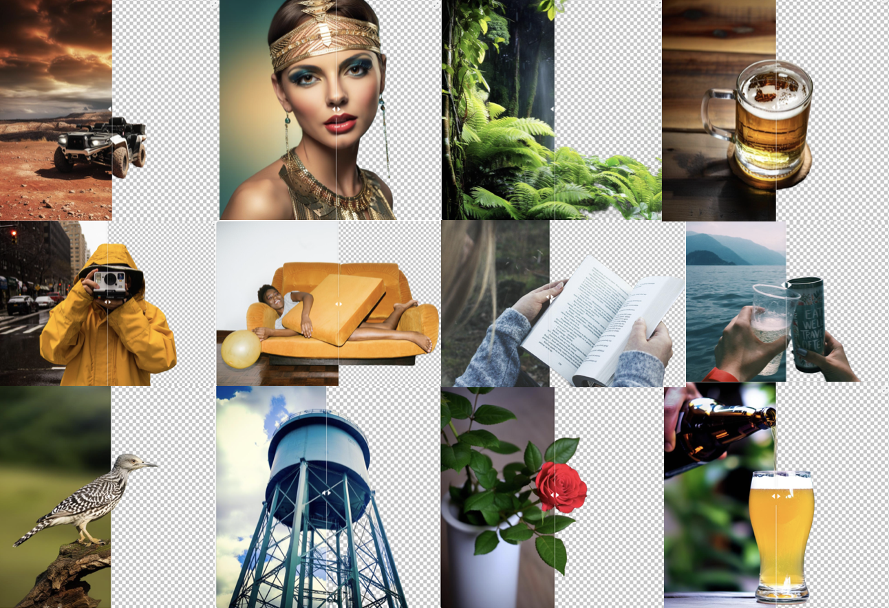
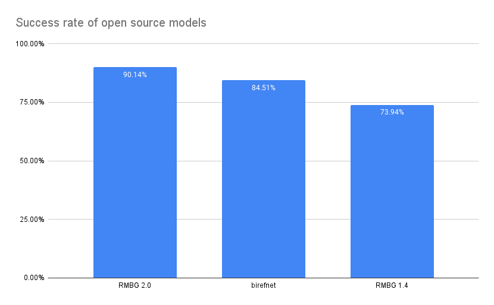

# BRIA Background Removal (RMBG)
<p align="center"></p>

<p align="center">
  
  
  
  <a href="https://huggingface.co/briaai/RMBG-3.0">
    
  </a>
  <a href="https://huggingface.co/briaai/RMBG-2.0">
    
  </a>
  <a href="https://huggingface.co/spaces/briaai/BRIA-RMBG-3.0">
    
  </a>
  <a href="https://huggingface.co/spaces/briaai/BRIA-RMBG-2.0">
    
  </a>
</p>

This repository covers Bria's two current background removal models. Both are trained exclusively on licensed data
and both return a single-channel 8-bit alpha matte (white = subject, black = background) that you can use directly
as an alpha channel or threshold into a binary mask.

- **[RMBG-3.0](#rmbg-30)** is the newest model and the first one built on a generative foundation (Fibo 2.0). It gives the best quality on hard images.
- **[RMBG-2.0](#rmbg-20)** is a BiRefNet segmentation model. It is much smaller and faster, and runs on small GPUs.

Developed by BRIA AI, both models are available as source-available models for non-commercial use.

### Which model should I use?

| | RMBG-3.0 | RMBG-2.0 |
| --- | --- | --- |
| Approach | Generative, editing-based (Fibo 2.0) | Segmentation (BiRefNet) |
| Parameters | 8B | 0.2B |
| Quality on hard images | Best | Good |
| Speed | ~6 s / image (L40S) | Much faster, single forward pass |
| GPU memory | 32 GB+ | Fits on small GPUs |
| Library | Diffusers (`BriaFibo2Pipeline`) | Transformers (`trust_remote_code`) |
| Best for | Hard images, product catalogs, quality-first workflows | High-volume, low-latency jobs and edge devices |

### Get Access

Both models are available everywhere you build, either as source-code and weights, ComfyUI nodes or API endpoints.

| | RMBG-3.0 | RMBG-2.0 |
| --- | --- | --- |
| **Weights** | [briaai/RMBG-3.0](https://huggingface.co/briaai/RMBG-3.0) | [briaai/RMBG-2.0](https://huggingface.co/briaai/RMBG-2.0) |
| **Demo** | [Space](https://huggingface.co/spaces/briaai/BRIA-RMBG-3.0), [API sandbox](https://platform.bria.ai/image-editing/remove-background/sandbox) | [Space](https://huggingface.co/spaces/briaai/BRIA-RMBG-2.0) |
| **API Endpoint** | [Bria.ai](https://docs.bria.ai/image-editing/v2-endpoints/background-remove), [fal.ai](https://fal.ai/models/bria/rmbg-3) | [Bria.ai](https://platform.bria.ai/console/api/image-editing), [fal.ai](https://fal.ai/models/fal-ai/bria/background/remove), [Replicate](https://replicate.com/bria/remove-background) |
| **ComfyUI** | [Use it in workflows](https://github.com/Bria-AI/ComfyUI-BRIA-API) | [Use it in workflows](https://github.com/Bria-AI/ComfyUI-BRIA-API) |
| **Commercial license** | [Purchase](http://platform.bria.ai/licensing/pricing?model=rmbg-3.0) | [Purchase](https://share-eu1.hsforms.com/2sj9FVZTGSFmFRibDLhr_ZAf4e04) |

For more information, please visit our [website](https://bria.ai/).

Join our [Discord community](https://discord.gg/Nxe9YW9zHS) for more information, tutorials, tools, and to connect with other users!

## Quick start

[`remove_bg.py`](remove_bg.py) runs either model from the command line and writes `<name>_cutout.png`, the original
image with the predicted matte as its alpha channel.

Both sets of weights are gated on Hugging Face. Accept the access form on the model page first (for RMBG-3.0 also on
[Fibo 2.0 Edit Turbo](https://huggingface.co/briaai/Fibo-2.0-edit-turbo), which provides the rest of the pipeline),
then log in:

```bash
hf auth login
```

**RMBG-2.0**

```bash
pip install -r requirements.txt
```

```bash
python remove_bg.py photo.jpg
```

**RMBG-3.0** (CUDA GPU with 32 GB or more)

```bash
pip install -r requirements-rmbg3.txt
```

```bash
python remove_bg.py photo.jpg --model 3.0
```

Options:

| Option | Meaning |
| --- | --- |
| `--model {2.0,3.0}` | Which model to run. Default `2.0`. |
| `-o`, `--output-dir DIR` | Where to write results. Default: next to each input. |
| `--matte` | Also save the grayscale matte as `<name>_matte.png`. |
| `--device` | `cuda`, `mps`, `cpu` or `auto`. Default `auto`. |
| `--seed` | Random seed, RMBG-3.0 only. Default `0`. |

Several images can be passed at once; the model is loaded once and reused.

# RMBG-3.0

RMBG 3.0 is the third generation of Bria's background removal models, and the first one built on a generative
foundation. It is Fibo 2.0, fine-tuned and distilled to turn a photo into a clean, soft alpha matte in 4 steps.
Instead of learning edges from labelled masks, it treats background removal as an image edit: the input photo goes in
as the context image, a fixed instruction asks for an alpha matte, and the model renders the matte.

See the [model card](https://huggingface.co/briaai/RMBG-3.0) for examples and the full evaluation.

[CLICK HERE FOR A DEMO](https://huggingface.co/spaces/briaai/BRIA-RMBG-3.0)

## Model Details

- **Developed by:** [BRIA AI](https://bria.ai/)
- **Model type:** Background Removal
- **Foundation:** [Fibo 2.0](https://huggingface.co/briaai/Fibo-2.0-dev), an 8B-parameter flow-matching DiT with a Qwen3-VL-4B prompt and image encoder, operating in the FLUX.2 VAE latent space.
- **Fine-tuning:** trained for alpha matting on licensed data, starting from Fibo 2.0's editing weights.
- **Distillation:** distilled to 4 steps without classifier-free guidance.
- **License:** [Creative Commons Attribution–Non-Commercial (CC BY-NC 4.0)](https://creativecommons.org/licenses/by-nc/4.0/deed.en)
  - The weights are released under a CC BY-NC 4.0 license for non-commercial use.
  - Commercial use requires a separate agreement with BRIA. Get a license [here](http://platform.bria.ai/licensing/pricing?model=rmbg-3.0), or use the commercially licensed [Bria API](https://docs.bria.ai/image-editing/v2-endpoints/background-remove) or [fal endpoint](https://fal.ai/models/bria/rmbg-3).

## Evaluation

In Bria's own benchmark, RMBG-3.0 was compared with Photoroom, remove.bg (Canva), Ideogram, BiRefNet and RMBG-2.0 on
234 deliberately hard images at full resolution. Every image was ranked 1–6 (1 = best) by blind user voting combined
with a VLM side-by-side comparison.

- Average rank 1.51, best or tied-best on 185 of the 234 images.
- Preferred head to head 55.1% vs Photoroom, 59.4% vs remove.bg (Canva), 60.9% vs RMBG-2.0, 65.6% vs Ideogram and 75.9% vs BiRefNet.

The full numbers and per-category results are on the [model card](https://huggingface.co/briaai/RMBG-3.0).

## Requirements
```bash
diffusers>=0.42.0
torch
torchvision
transformers
accelerate
```

## Usage

The RMBG-3.0 repo holds only the fine-tuned transformer. The rest of the pipeline (text encoder, VAE, fonts) comes
from [Fibo 2.0 Edit Turbo](https://huggingface.co/briaai/Fibo-2.0-edit-turbo), so accept its access form first.

```python
import json

import torch
from diffusers import AutoModel, BriaFibo2Pipeline
from huggingface_hub import hf_hub_download
from PIL import Image

BASE = "briaai/Fibo-2.0-edit-turbo"

# The fixed instruction. Use exactly this text for every image.
INSTRUCTION = (
    "Generate a detailed grayscale alpha matte. Map the opaque foreground to white and the "
    "background to black. Produce soft, anti-aliased grayscale gradients at the edges of the "
    "subject to represent fine details and transparency."
)
PROMPT = json.dumps({"edit_instruction": INSTRUCTION})

transformer = AutoModel.from_pretrained(
    "briaai/RMBG-3.0", subfolder="transformer", dtype=torch.bfloat16
)
pipe = BriaFibo2Pipeline.from_pretrained(
    BASE, transformer=transformer, dtype=torch.bfloat16
).to("cuda")
fonts = [hf_hub_download(BASE, n, subfolder="fonts") for n in ("Aileron-Regular.otf", "DejaVuSans.ttf")]

source = Image.open("photo.jpg").convert("RGB")
result = pipe(
    prompt=PROMPT,
    image=source,
    num_inference_steps=4,
    guidance_scale=1.0,
    generator=torch.Generator("cuda").manual_seed(0),
    fonts=fonts,
).images[0]

matte = result.convert("L").resize(source.size, Image.LANCZOS)  # white = keep
cutout = source.copy()
cutout.putalpha(matte)
cutout.save("photo_cutout.png")
```

| Setting | Value | Why |
| --- | --- | --- |
| `num_inference_steps` | 4 | The model was distilled to finish in 4 steps. |
| `guidance_scale` | 1.0 | No classifier-free guidance, as in Fibo 2.0 Edit Turbo. |
| Prompt | the fixed instruction | The model was trained on this exact text and nothing else. A changed or missing instruction gives a coloured picture instead of a matte. |
| GPU memory | 32 GB or more | Measured peak 28.5 GiB on one L40S, with the whole pipeline in bf16. |
| Speed | about 6 s per image | Measured on one L40S at about 1 megapixel, including text encoding and decoding. |

### Bria API

Commercially licensed, fully managed, no GPU required:

```bash
curl -X POST "https://engine.prod.bria-api.com/v2/image/edit/remove_background" \
  -H "api_token: $BRIA_API_TOKEN" \
  -H "Content-Type: application/json" \
  -d '{"image": "https://d1uqrfwi55x6ib.cloudfront.net/rmbg-3.0-dev/assets/rmbg3_example_input_dog.jpg", "model": "RMBG3"}'
```

## Limitations

- **True transparency.** Glass, nets, veils, smoke and splashes tend to come out opaque.
- **Busy and low-contrast scenes.** RMBG-3.0 sometimes pulls in grass, props or a watermark next to the subject. RMBG-2.0 does better on white-on-white and camouflage shots.
- **Thin structures.** Very fine structures such as insect wings and spokes can be slightly weaker than the best competing result.
- **Rare broken outputs.** RMBG-3.0 ranked last on 5 of the 234 benchmark images.
- **Compute.** At 8B parameters it needs a large GPU. For lightweight deployment, use the Bria API or RMBG-2.0.

## Citation

RMBG 3.0 is built on the FIBO family. If you use it in your research, please cite:

```
@article{gutflaish2025generating,
  title={Generating an Image From 1,000 Words: Enhancing Text-to-Image With Structured Captions},
  author={Gutflaish, Eyal and Kachlon, Eliran and Zisman, Hezi and Hacham, Tal and Sarid, Nimrod and Visheratin, Alexander and Huberman, Saar and Davidi, Gal and Bukchin, Guy and Goldberg, Kfir and others},
  journal={arXiv preprint arXiv:2511.06876},
  year={2025}
}
```

# RMBG-2.0

<p>
  
</p>

RMBG v2.0 is our state-of-the-art segmentation-based background removal model and significantly improves RMBG v1.4. The model is designed to effectively separate foreground from background in a range of
categories and image types. This model has been trained on a carefully selected dataset, which includes:
general stock images, e-commerce, gaming, and advertising content, making it suitable for commercial use cases powering enterprise content creation at scale. 
The accuracy, efficiency, and versatility currently rival leading source-available models. 
It is ideal where content safety, legally licensed datasets, and bias mitigation are paramount. 

The model code in this repository ([`birefnet.py`](birefnet.py), [`BiRefNet_config.py`](BiRefNet_config.py), [`config.json`](config.json)) is the RMBG-2.0 implementation.

[CLICK HERE FOR A DEMO](https://huggingface.co/spaces/briaai/BRIA-RMBG-2.0)



## Model Details
#####
### Model Description

- **Developed by:** [BRIA AI](https://bria.ai/)
- **Model type:** Background Removal 
- **License:** [Creative Commons Attribution–Non-Commercial (CC BY-NC 4.0)](https://creativecommons.org/licenses/by-nc/4.0/deed.en)
  - The model is released under a CC BY-NC 4.0 license for non-commercial use.
  - Commercial use is subject to a commercial agreement with BRIA. Available [here](https://share-eu1.hsforms.com/2sj9FVZTGSFmFRibDLhr_ZAf4e04?utm_campaign=RMBG%202.0&utm_source=Hugging%20face&utm_medium=hyperlink&utm_content=RMBG%20Hugging%20Face%20purchase%20form)

  **Purchase:** to purchase a commercial license simply click [Here](https://go.bria.ai/3D5EGp0).

- **Model Description:** BRIA RMBG-2.0 is a dichotomous image segmentation model trained exclusively on a professional-grade dataset. The model output includes a single-channel 8-bit grayscale alpha matte, where each pixel value indicates the opacity level of the corresponding pixel in the original image. This non-binary output approach offers developers the flexibility to define custom thresholds for foreground-background separation, catering to varied use cases requirements and enhancing integration into complex pipelines.
- **BRIA:** Resources for more information: [BRIA AI](https://bria.ai/)


## Training data
Bria-RMBG model was trained with over 15,000 high-quality, high-resolution, manually labeled (pixel-wise accuracy), fully licensed images.
Our benchmark included balanced gender, balanced ethnicity, and people with different types of disabilities.
For clarity, we provide our data distribution according to different categories, demonstrating our model’s versatility.

### Distribution of images:

| Category | Distribution |
| -----------------------------------| -----------------------------------:|
| Objects only | 45.11% |
| People with objects/animals | 25.24% |
| People only | 17.35% |
| people/objects/animals with text | 8.52% |
| Text only | 2.52% |
| Animals only | 1.89% |

| Category | Distribution |
| -----------------------------------| -----------------------------------------:|
| Photorealistic | 87.70% |
| Non-Photorealistic | 12.30% |


| Category | Distribution |
| -----------------------------------| -----------------------------------:|
| Non Solid Background | 52.05% |
| Solid Background | 47.95% 


| Category | Distribution |
| -----------------------------------| -----------------------------------:|
| Single main foreground object | 51.42% |
| Multiple objects in the foreground | 48.58% |


## Qualitative Evaluation
Open source models comparison



### Architecture
RMBG-2.0 is developed on the [BiRefNet](https://github.com/ZhengPeng7/BiRefNet) architecture enhanced with our proprietary dataset and training scheme. This training data significantly improves the model’s accuracy and effectiveness for background-removal task.<br>
If you use this model in your research, please cite:

```
@article{BiRefNet,
  title={Bilateral Reference for High-Resolution Dichotomous Image Segmentation},
  author={Zheng, Peng and Gao, Dehong and Fan, Deng-Ping and Liu, Li and Laaksonen, Jorma and Ouyang, Wanli and Sebe, Nicu},
  journal={CAAI Artificial Intelligence Research},
  year={2024}
}
```

#### Requirements
```bash
torch
torchvision
pillow
kornia
timm
transformers
```

### Usage

<!-- This section is for the model use without fine-tuning or plugging into a larger ecosystem/app. -->


```python
from PIL import Image
import matplotlib.pyplot as plt
import torch
from torchvision import transforms
from transformers import AutoModelForImageSegmentation

model = AutoModelForImageSegmentation.from_pretrained('briaai/RMBG-2.0', trust_remote_code=True)
torch.set_float32_matmul_precision(['high', 'highest'][0])
model.to('cuda')
model.eval()

# Data settings
image_size = (1024, 1024)
transform_image = transforms.Compose([
    transforms.Resize(image_size),
    transforms.ToTensor(),
    transforms.Normalize([0.485, 0.456, 0.406], [0.229, 0.224, 0.225])
])

image = Image.open(input_image_path)
input_images = transform_image(image).unsqueeze(0).to('cuda')

# Prediction
with torch.no_grad():
    preds = model(input_images)[-1].sigmoid().cpu()
pred = preds[0].squeeze()
pred_pil = transforms.ToPILImage()(pred)
mask = pred_pil.resize(image.size)
image.putalpha(mask)

image.save("no_bg_image.png")
```

